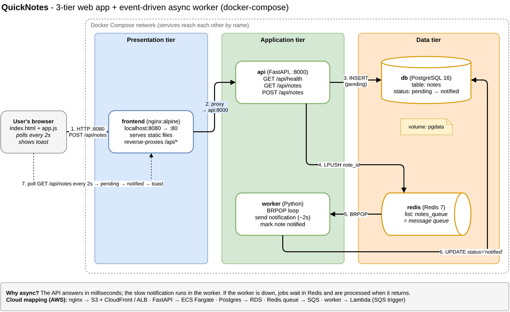

# QuickNotes: Application Architecture

**Assignment 1, Application Architecture Design** · Ammara · November 2026

## 1. Overview
QuickNotes is a small notes app built to show a complete system end to end. A user types a note and clicks **Add**. The note is saved right away as `pending`, a background worker then sends a "note saved" notification, and the note becomes `notified`. The page picks up the change and shows a toast. The whole system runs locally with one command (`docker compose up --build`).

**Architecture style:** a classic **3-tier** design (presentation, application, data) plus an **event-driven asynchronous worker** connected through a message queue.

## 2. Components
| Tier | Service | Technology | Responsibility |
|---|---|---|---|
| Presentation | `frontend` | nginx + plain HTML/JS | Serves the UI; reverse-proxies `/api/*` to the API. The only service exposed to the host (port 8080) |
| Application | `api` | Python, FastAPI | Validates input, writes to the database, enqueues jobs, serves the notes list |
| Application (async) | `worker` | Python | Consumes jobs from the queue, sends the notification, updates the note |
| Data | `db` | PostgreSQL 16 | Source of truth: the `notes` table. Data kept in a named volume |
| Data / messaging | `redis` | Redis 7 (list) | Queue (`notes_queue`) that decouples the API from the worker |

## 3. Request flow
1. The browser sends `POST /api/notes` to nginx on `localhost:8080`.
2. nginx forwards `/api/*` to `api:8000`. Browser and API share one origin, so CORS isn't needed.
3. The API validates the text (it must not be empty, otherwise 422) and runs `INSERT ... status='pending'`.
4. The API pushes the note id onto Redis (`LPUSH notes_queue`) and returns `201` immediately.
5. The worker is blocked on `BRPOP notes_queue`. It receives the id and sends the notification (simulated as a 2s call).
6. The worker runs `UPDATE notes SET status='notified', notified_at=now()`.
7. While any note is pending, the browser polls `GET /api/notes` every 2s. When it sees the change it shows "Note #N saved".

## 4. Key design decisions
- **Three tiers.** Each tier can be changed, scaled and secured on its own. For example, the UI could move to a CDN without touching the API.
- **Async work through a queue.** The user never waits for slow external calls. If the worker is down, jobs wait in Redis and are processed when it comes back. I tested this by stopping the worker: the note stayed `pending`, the queue length was 1, and starting the worker processed it.
- **Reverse proxy in front of the API.** The API isn't exposed publicly, there is a single entry point, and no CORS configuration is needed.
- **No slow work inside a DB transaction.** The worker reads the note, calls the notifier, then writes in a new transaction, so it never holds a database transaction open while waiting on another service.
- **Configuration through environment variables** (`.env`, not committed). The same images run on a laptop, in CI or in the cloud.
- **Healthchecks.** With `depends_on: service_healthy`, the API and worker start only after Postgres and Redis accept connections.
- **Simplicity choices:** plain SQL (no ORM) and polling instead of WebSockets. Both keep every step visible, at the cost of some efficiency.

## 5. Scalability and reliability
- **Stateless API and worker.** Both can be scaled horizontally, for example `docker compose up --scale worker=3`. Redis hands each job to exactly one worker.
- **Failure isolation.** If the worker or notifier fails, adding notes still works. If the database fails, writes fail, so the database is the main single point of failure. In the cloud this would be Multi-AZ RDS.
- **Known limitations (acceptable for this scope):**
  - If the Redis push fails after the INSERT, that note stays `pending`. The fix is a transactional outbox or a periodic re-queue of old pending notes.
  - `BRPOP` removes the job before it's processed, so a worker crash mid-job loses that job (at-most-once delivery). SQS avoids this with a visibility timeout and a dead-letter queue.
  - Polling adds load as the number of users grows. WebSockets or Server-Sent Events would push updates instead.

## 6. Security
- Only nginx is published to the host. Postgres, Redis and the API are reachable only on the internal Docker network.
- Secrets live in `.env`, which is git-ignored. In production they would go in a secrets manager.
- Input is validated by Pydantic, SQL uses parameterised queries (no injection), and the UI inserts note text with `textContent` (no XSS).
- Not yet covered: authentication, HTTPS/TLS and rate limiting.

## 7. Mapping to the cloud (AWS)
**nginx** → S3 + CloudFront / ALB · **FastAPI** → ECS Fargate · **PostgreSQL** → RDS · **Redis queue** → SQS · **Worker** → Lambda (SQS trigger) · `.env` → Secrets Manager. The code stays the same; only the hosting changes.

## 8. Testing and next steps
API unit tests (`docker compose run --rm api pytest -q`, 3 passing) fake the database and queue, so they need no infrastructure. **Next (assignment 2, CI/CD):** run these tests on every push, build and tag images, push them to a registry and deploy.
